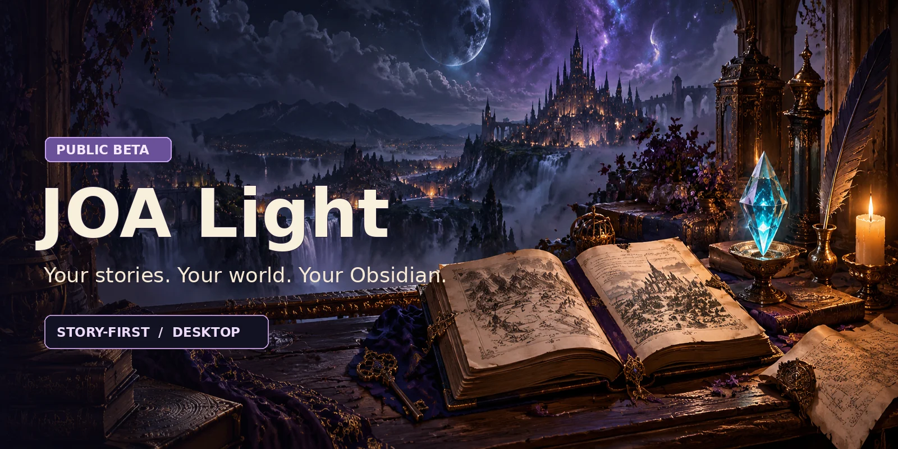
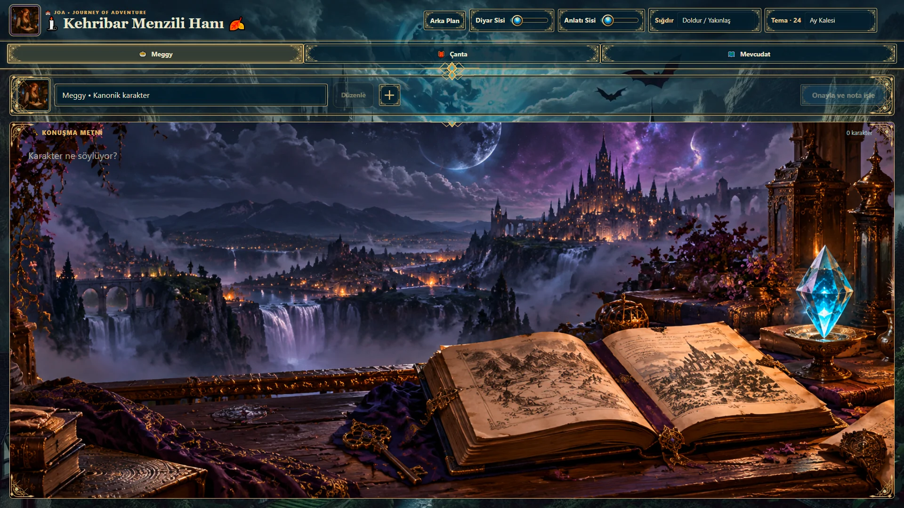
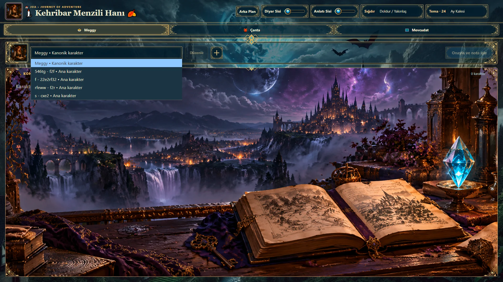
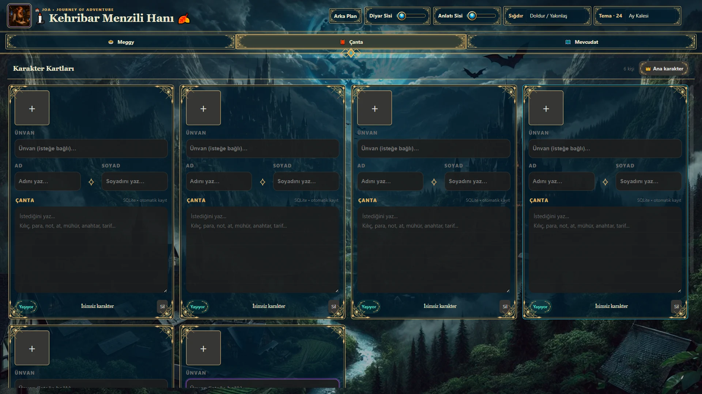
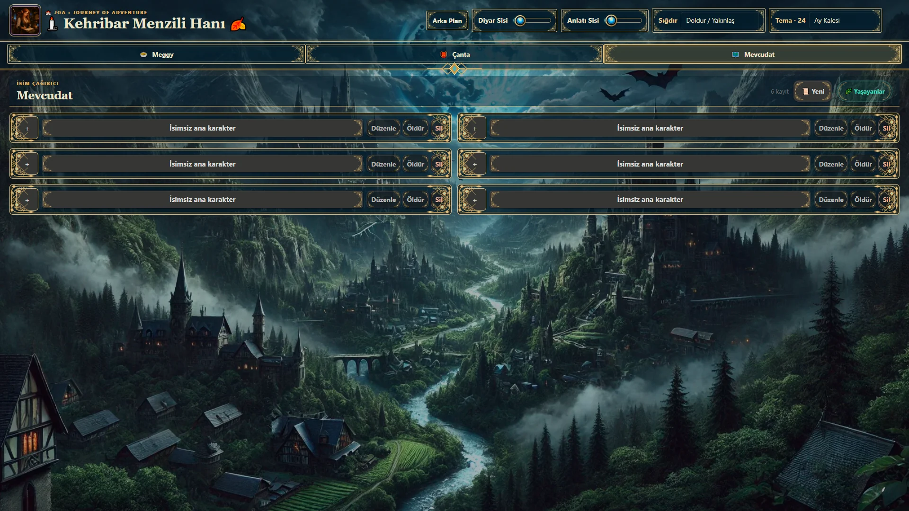
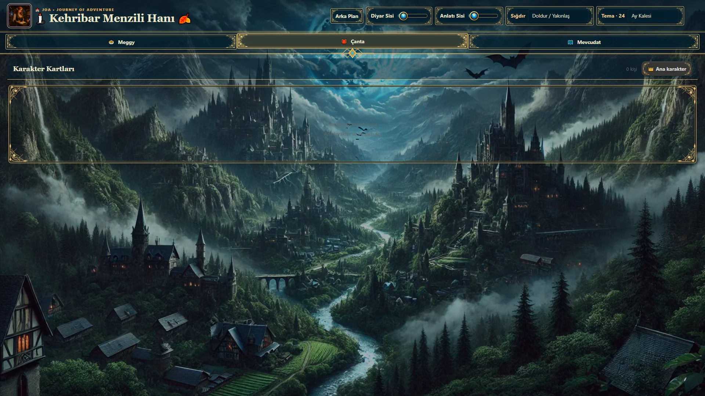
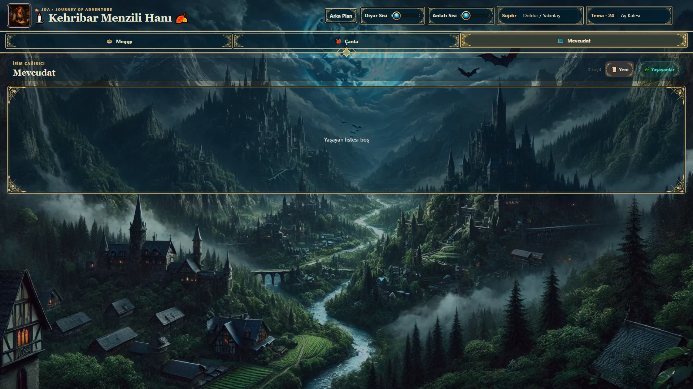
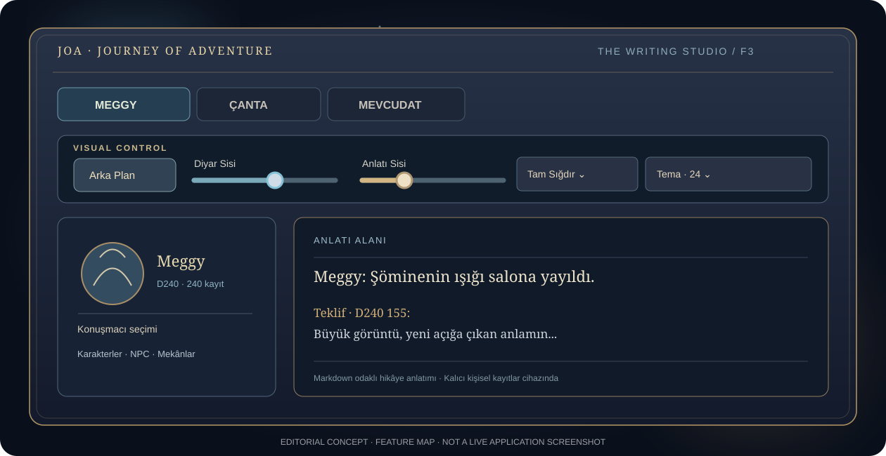
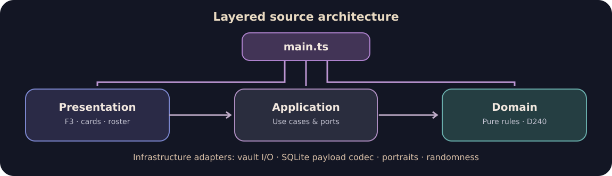

<div align="center">



<br />

# ✦ JOA LIGHT

### Your story stays on the page. Your world stays within reach.

**A fantasy writing companion for Obsidian Desktop.**  
*Write in Markdown. Give your characters a voice. Keep your world close.*


<br />

[**✦ Explore the showroom**](#the-studio-in-action) &nbsp;·&nbsp; [**⚔ What it does**](#made-for-storytellers) &nbsp;·&nbsp; [**↓ Install**](#installation) &nbsp;·&nbsp; [**⌘ Engineering**](#behind-the-curtain) &nbsp;·&nbsp; [**Türkçe**](./docs/README_TR.md)


</div>

> [!IMPORTANT]
> **v1.0.0 · Beta · Obsidian Desktop only.** This is a third-party plugin, not an official Obsidian product or a Community Plugins listing. The code is **source-available, not open source**. Please back up your vault before installing. Read the [license](./LICENSE) and [known limitations](./docs/ROADMAP.md).

---

## A writing desk between worlds

A character speaks. The story moves. Somewhere behind the words are names, portraits, bags, companions, places and details that must not get lost.

**JOA Light brings those details into an F3 writing studio without moving your manuscript out of Obsidian.** Your story is still an ordinary `.md` note. Character and roster records live alongside it in local plugin storage, not in a proprietary manuscript format.

<div align="center">

| `F3` | `24` | `D240` | `.md` |
| :---: | :---: | :---: | :---: |
| Open the studio | Fantasy themes | 240 numbered Meggy events | Your own manuscript |

</div>

## The studio in action

<sub>REAL UI SCREENSHOTS · The images below were supplied from the running JOA Light interface. They are separate from the promotional cover artwork.</sub>

### 01 / When a character speaks

<div align="center">

<a href="./assets/showroom/01-writing-studio-meggy.webp"></a>

<sub><b>THE WRITING STUDIO</b> · Meggy selected · atmospheric writing surface · independent background and narrative blur.</sub>

</div>

From an open Markdown note, press **F3**, select the speaker, enter dialogue and confirm. The result goes into the note as readable Markdown. The illustration sets the mood; it does not replace your editor.

### 02 / A voice for every character

<div align="center">

<a href="./assets/showroom/06-speaker-selector-dropdown.webp"></a>

<sub><b>SPEAKER SELECTOR</b> · Switch between canonical Meggy and your own character speakers.</sub>

</div>

### 03 / The people and the world behind the story

<table>
<tr>
<td width="50%" valign="top">
<a href="./assets/showroom/04-character-cards-populated.webp"></a>
<br /><strong>Character cards</strong><br /><sub>Portraits, names, titles, living status and freeform bag notes.</sub>
</td>
<td width="50%" valign="top">
<a href="./assets/showroom/05-mevcudat-populated.webp"></a>
<br /><strong>Mevcudat roster</strong><br /><sub>A compact working list with edit, life-status and delete actions.</sub>
</td>
</tr>
</table>

<details>
<summary><strong>✦ See the clean-slate views (2 more screenshots)</strong></summary>
<br />
<table>
<tr>
<td width="50%" valign="top">
<a href="./assets/showroom/02-character-cards-empty.webp"></a>
<br /><sub>Character cards · empty state</sub>
</td>
<td width="50%" valign="top">
<a href="./assets/showroom/03-mevcudat-empty.webp"></a>
<br /><sub>Mevcudat · empty state</sub>
</td>
</tr>
</table>
</details>

> Screenshots illustrate the interface as captured; the demonstration entries are not bundled as starter characters. Your personal notes, portraits and database are **not** included in the distribution.

---

## Made for storytellers

<table>
<tr>
<td width="50%" valign="top">

### 🗝️ Write first

Open the F3 studio while a Markdown note is active. Choose a speaker and insert dialogue into your story. JOA Light remembers note-specific writing positions.

</td>
<td width="50%" valign="top">

### 💠 Keep the cast close

Main characters have portrait controls, names, optional titles, living/dead state and bag notes. The roster makes other entities available without leaving your scene.

</td>
</tr>
<tr>
<td valign="top">

### 🗺️ Three connected views

**Meggy** for dialogue, **Çanta** for main-character cards and bags, **Mevcudat** for the wider roster. Your working context is only a tab away.

</td>
<td valign="top">

### ✧ Meggy's D240

Only canonical Meggy triggers a roll of **1–240**. The corresponding exact sentence and a label selected from **24 event variants** are inserted. The matching `MV1.mp3`–`MV240.mp3` recording plays locally.

</td>
</tr>
</table>

### Atmosphere is part of the experience

| Control | Experience |
| --- | --- |
| **Tema · 24** | Switch between 24 named fantasy themes. |
| **Arka Plan** | Select a JPG, PNG or WebP background from your device. |
| **Diyar Sisi** | Blur **only the main studio backdrop**, independently from 0–24 px. |
| **Anlatı Sisi** | Blur **only the narrative illustration** behind the writing field, independently from 0–24 px. |
| **Sığdır** | Choose cover, contain, width, height or natural-size display modes. |

<details>
<summary><strong>View the annotated studio diagram</strong></summary>
<br />
<div align="center"></div>
</details>

### Markdown that remains yours

A dialogue line is inserted as text, **not a proprietary block**. For illustration only, the following D240 example is not a quote from the bundled canonical dataset:

```md
Meggy: The candles are still burning. The map can wait.

**Teklif · D240 155:** A new possibility comes into view.
```

The event label and sentence remain **on one line**. Other speakers insert dialogue without triggering Meggy's D240/audio behavior.

---

## Installation

**Requirements:** Obsidian **desktop** (manifest minimum **1.4.0**), a writable vault and the complete plugin distribution. Mobile is not supported.

1. **Back up your vault**, particularly existing JOA Light data and personal artwork.
2. Get the release ZIP from [GitHub Releases](https://github.com/TheDEvorger/Alekrythae-JOA-Light-Obsidian/releases) **when an installation archive has been published**. A GitHub-generated *Source code (zip)* may not equal the tested distribution.
3. Extract the single `joa-frp-writer/` folder into your vault's `.obsidian/plugins/` directory.
4. In Obsidian, go to **Settings → Community plugins**, enable **JOA Light**, open a `.md` note and press **F3**.

```text
YOUR-VAULT/
└── .obsidian/
    └── plugins/
        └── joa-frp-writer/
            ├── manifest.json            ← plugin metadata
            ├── main.js                  ← compiled runtime
            ├── styles.css               ← compiled styles
            ├── audio/                   ← MV1–MV240
            ├── background-images/
            │   └── default.webp
            ├── assets/
            │   └── anlati-panel.png
            ├── src/                     ← auditable TypeScript source
            ├── styles/                  ← modular CSS source
            └── tests/                   ← regression tests
```

> [!CAUTION]
> **Existing installation? Never replace your personal data with a clean starter.** Preserve `data.json`, `sqlite/`, `art/` and custom `background-images/`. Those paths are deliberately absent from the GitHub starter package. On a *new* installation, an empty local SQLite-backed database is created when first needed.

<details>
<summary><strong>Where your data actually lives</strong></summary>
<br />

| Local path | Contents |
| --- | --- |
| `data.json` | Local appearance preferences and writing positions |
| `sqlite/inventory.sqlite` | Character, bag and roster state |
| `sqlite/inventory.sqlite.bak` | Previous-state recovery copy |
| `art/` | User portraits |
| `background-images/` | Bundled starter background plus user-selected custom wallpapers |

None of those personal runtime files should be uploaded to GitHub. The bundled `background-images/default.webp` is the exception.

</details>

---

## Behind the curtain

<div align="center"></div>

JOA Light uses **modular TypeScript** for the plugin and **feature-scoped CSS** for its UI. Domain logic, application use cases, storage adapters and presentation components are organized separately. The runtime files loaded by Obsidian are generated by the build.

```text
src/
├── domain/           D240, models, domain rules
├── application/      use cases and interfaces
├── infrastructure/   Obsidian adapters and local persistence
├── presentation/     studio, character roster and UI controls
└── main.ts           composition root
styles/               modular styling
scripts/              publication / repository safety checks
tests/                Node regression tests
```

**For contributors:** Node.js ≥22 and the pinned TypeScript **5.9.3**. Install from the lockfile and run the project checks:

```bash
npm ci --ignore-scripts
npm run security:check
npm test
```

Local regression checks can be run with `npm test`; there is no GitHub CI workflow. A prior verification reported **184 passing tests**. This is **not** a promise of complete platform compatibility or a security certification. See [architecture](./ARCHITECTURE.md), [development](./docs/DEVELOPMENT.md), [release guide](./docs/RELEASE_GUIDE.md) and [verification notes](./docs/VERIFICATION_2026-10-11_TR.md).

## Security, data & known boundaries

**Local-first, not cloud-dependent.** The reviewed plugin source does not intentionally implement remote accounts, analytics or telemetry. It also does **not** encrypt local files.

- **Repository hygiene:** `.gitignore`, tracked-file privacy checks and security-focused publication scripts protect against common accidental inclusions. They cannot undo previously pushed data.
- **Data validation:** Fixed SQLite container format, JSON schema checks, pre-write validation, staged writes and recovery copies are implemented. This is **not** a general-purpose relational SQLite database: the current container is 131,072 bytes with approximately **60 KiB** of JSON capacity.
- **Media:** Local image type, size, dimension and signature checks are present. The 240 paired MP3 files remain on-device.
- **Verification limits:** Full live Windows/Obsidian acceptance, independent penetration testing and live dependency security auditing have **not** been completed. Obsidian plugins run with broad host privileges; install only code you trust.

[Security policy](./SECURITY.md) · [Assessment & limits](./docs/SECURITY_AUDIT.md) · [Data & privacy](./docs/DATA_AND_PRIVACY.md) · [GitHub hardening](./docs/REPOSITORY_SECURITY.md)

<details>
<summary><strong>Project docs & provenance</strong></summary>
<br />

[🇹🇷 Türkçe rehber](./docs/README_TR.md) · [User guide](./docs/USER_GUIDE.md) · [Changelog](./CHANGELOG.md) · [Release notes](./RELEASE_NOTES.md)  
[GitHub yayını (TR)](./docs/GITHUB_YAYIN_TR.md) · [Modules](./MODULES.md) · [Asset provenance](./docs/ASSET_PROVENANCE.md) · [Third-party notices](./THIRD_PARTY_NOTICES.md)

</details>

---

<div align="center">

### ✦ Another page. Another character. Another world.

**[Explore screenshots](#the-studio-in-action) · [Install JOA Light](#installation) · [Technical details](#behind-the-curtain) · [Türkçe](./docs/README_TR.md)**

<sub>© 2026–present TheDEvorger. All rights reserved.</sub>  
<sub>Licensed under the <a href="./LICENSE">TheDEvorger Universal Proprietary Software License v1.3</a>. Source-available, not open source. Independent of and not endorsed by Obsidian.</sub>

</div>
